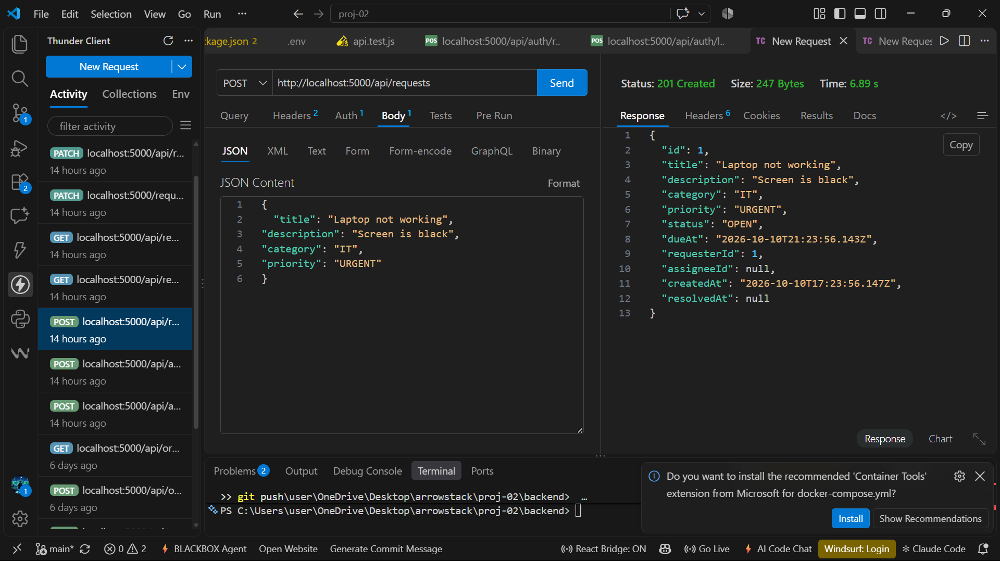
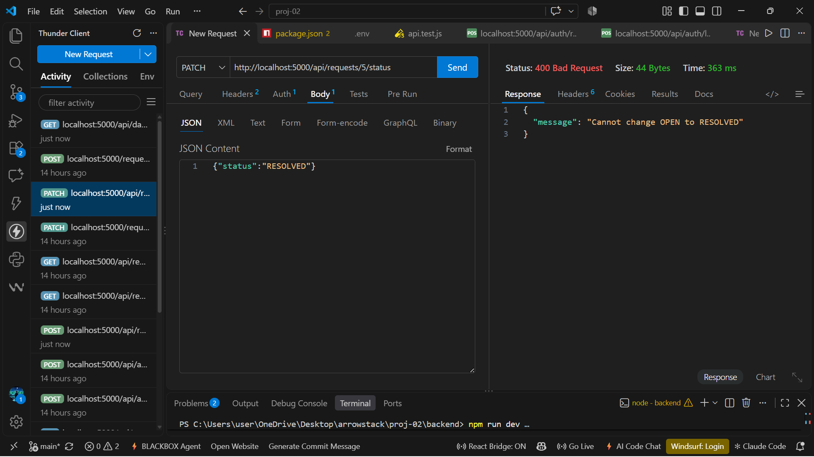
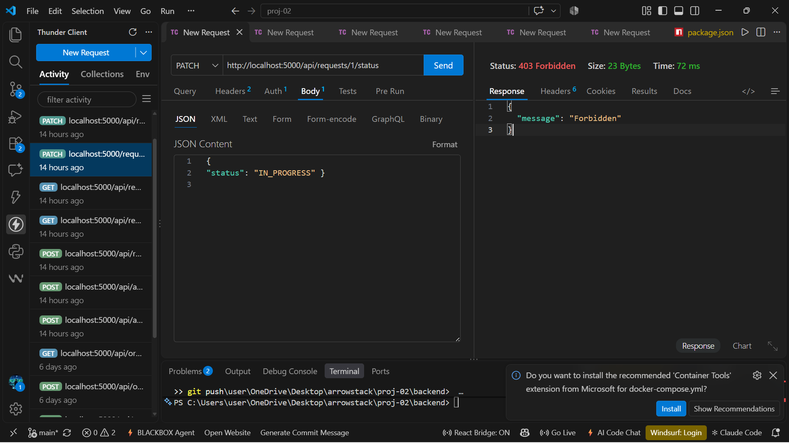
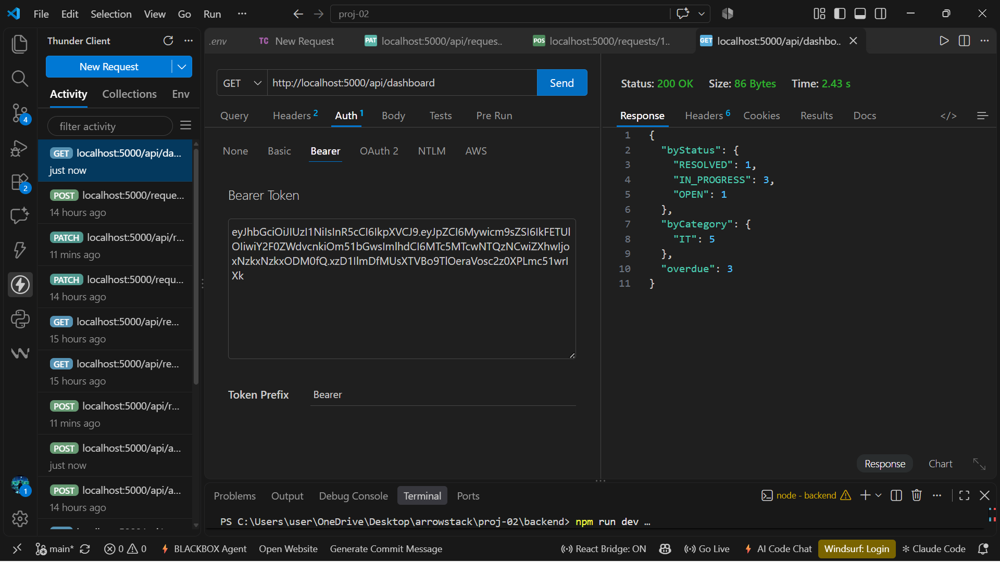
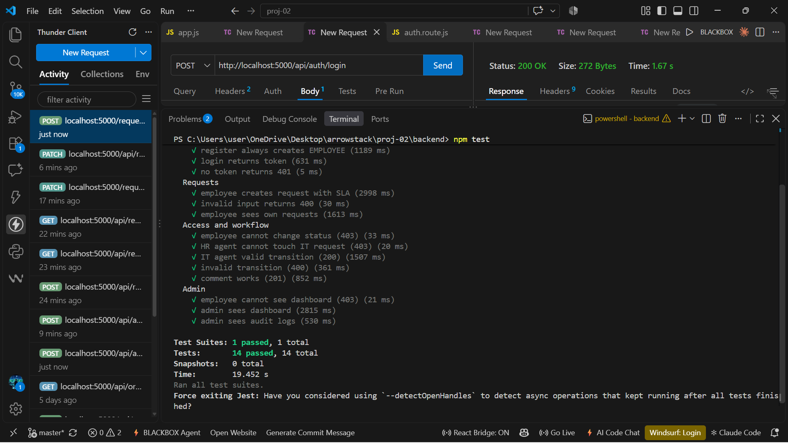

# Employee Service Request System

Internal portal where employees raise IT, HR and facility requests, which are auto-routed to an agent, tracked against SLA deadlines and summarised on an admin dashboard. Built with Node.js, Express, PostgreSQL (Prisma) and JWT role-based access. Arrowstack Full Stack internship, Project 2.

## Features

- Register / Login (JWT), roles: `EMPLOYEE`, `AGENT`, `ADMIN`
- Create requests by category (IT, HR, FACILITY) and priority
- Auto-routing to the agent of that category with the fewest open requests
- SLA deadline (`dueAt`) calculated from priority
- Status workflow: OPEN → IN_PROGRESS → RESOLVED → CLOSED (reopen allowed from RESOLVED)
- Role and category based visibility
- Comments on requests
- Admin dashboard: counts by status, by category, overdue requests
- Audit logs, Zod validation, global error handler, login rate limit

## Tech Stack

Node.js, Express, Prisma ORM, PostgreSQL (Neon), JWT, bcrypt, Zod, express-rate-limit, Jest, Supertest, Docker

## Demo

[Watch the demo video](https://drive.google.com/file/d/1SjWkU-HaP7Qeq3iMjbLyLjSNKGFiBV4c/view?usp=sharing)

## Setup

```bash
git clone https://github.com/Aiman-sandhu/employee-service-request-system.git
cd employee-service-request-system/backend
npm install
cp .env.example .env     # then fill in your own values
npx prisma migrate dev
npm run dev
```

The server runs at `http://localhost:5000`.

## Environment Variables

```
DATABASE_URL=
JWT_SECRET=
PORT=5000
TEST_ADMIN_EMAIL=
TEST_ADMIN_PASSWORD=
TEST_IT_EMAIL=
TEST_IT_PASSWORD=
TEST_HR_EMAIL=
TEST_HR_PASSWORD=
```

The `TEST_*` variables are existing accounts used only by the automated tests.

## Creating agents and admins

Registration always creates an `EMPLOYEE`. To promote a user (local admin script):

```bash
node makeAdmin.js admin@example.com ADMIN
node makeAdmin.js itagent@example.com AGENT IT
```

The user must log in again to get a token with the new role.

## Docker

```bash
docker compose up --build
```

Set `DATABASE_URL` and `JWT_SECRET` in `.env` first. The API runs at `http://localhost:5000`.

## Roles

| Role | Can do |
|---|---|
| EMPLOYEE | Create requests, view own requests, comment |
| AGENT | View requests of own category or assigned to them, change status, comment |
| ADMIN | See everything, assign agents, change status, dashboard, audit logs |

## SLA

| Priority | Hours to resolve |
|---|---|
| URGENT | 4 |
| HIGH | 24 |
| MEDIUM | 72 |
| LOW | 168 |

## API Endpoints

| Method | URL | Access |
|---|---|---|
| POST | /api/auth/register | Public |
| POST | /api/auth/login | Public (rate limited) |
| POST | /api/requests | Employee, Admin |
| GET | /api/requests | Any logged-in user (filtered by role) |
| GET | /api/requests/:id | Owner, assigned agent, category agent, Admin |
| PATCH | /api/requests/:id/status | Agent, Admin |
| PATCH | /api/requests/:id/assign | Admin |
| POST | /api/requests/:id/comments | Participants |
| GET | /api/dashboard | Admin |
| GET | /api/audit-logs | Admin |

Protected routes require the header: `Authorization: Bearer <token>`

## Request Flow

1. Validate input (Zod)
2. Pick the agent of that category with the fewest OPEN / IN_PROGRESS requests
3. Calculate `dueAt` from the priority
4. Create the request and its audit log in one `$transaction`



## Status Workflow

```
OPEN → IN_PROGRESS → RESOLVED → CLOSED
                ↑          |
                └──────────┘  (reopen)
```

Invalid jumps return `400`.



## Access Control

Employees cannot change status, and an agent cannot touch another category's requests. Both return `403`.



## Dashboard

Admin only: counts by status, counts by category and the number of overdue requests.



## Tests

Automated tests (Jest + Supertest) cover registration, SLA creation, validation, role and category access, status transitions, comments, dashboard and audit logs.

```bash
npm test
```



## Documentation

- [Requirements and acceptance criteria](backend/docs/requirements.md)
- [Decision log](backend/docs/decisions.md)

## Security Notes

- Passwords are hashed with bcrypt
- Registration never grants a role; users are always `EMPLOYEE`
- Login returns the same error for a wrong email and a wrong password
- Login is rate limited (10 attempts per 15 minutes)
- `.env` is never pushed to git

## Known Limitations and Next Steps

- No email notifications or escalation when an SLA is breached
- No file attachments
- Roles are stored in the JWT, so role changes apply after re-login
- Rate limiting is in-memory (use Redis for multiple servers)
- No pagination on request lists
- Possible improvements: React frontend, SLA pause/resume, reporting
